# Auditoría de accesibilidad del frontend de NailsSpa

Tarea **F16** · Repositorio `spa-frontend-web` · Guía: WCAG 2.2 nivel AA

Revisión de todas las pantallas del frontend (modo simulado) con los tres roles: Administrador, Gerente y Manicurista. Se probó con teclado, zoom del navegador, ancho de pantalla reducido, revisión visual, lector de pantalla (Narrador de Windows) y la herramienta axe (axe-core), que mide el contraste de color y los nombres accesibles. La revisión se hizo en dos momentos: **antes** de las correcciones (secciones 1 a 3) y **después** de aplicarlas (sección 4).

## 1. Hallazgos

El estado indica si el hallazgo quedó corregido en esta tarea.

| ID | Pantalla | Qué pasa | Cómo se probó | Rol | Tipo o criterio | Estado |
|---|---|---|---|---|---|---|
| H-01 | Login | El título muestra «Spa de Uñas» en lugar del nombre de la marca, NailsSpa. También estaba en el título de la pestaña del navegador y en el README. | Revisión visual | Sin sesión (pantalla pública) | Consistencia de marca | Corregido |
| H-02 | Menú | A partir de 200 % de zoom, el menú y el logo se superponen un poco (ver [Evidencia 1](#evidencia-1)). | Zoom | Todos los roles | WCAG 1.4.4 Cambio de tamaño del texto | Corregido (ver [Evidencia 9](#evidencia-9)) |
| H-03 | General | Al reducir el ancho del navegador, el menú se sale de su espacio y se superpone con el logo y con la pantalla de Inventario (ver [Evidencias 1](#evidencia-1) y [2](#evidencia-2)). | Zoom y ancho de ventana | Todos los roles | WCAG 1.4.10 Reflujo | Corregido (ver [Evidencia 9](#evidencia-9)) |
| H-04 | Inventario | El resaltado del foco en los productos del inventario es muy tenue y podría pasar desapercibido (ver [Evidencia 5](#evidencia-5)). | Teclado | Todos los roles | WCAG 2.4.7 Foco visible | Corregido (ver [Evidencia 10](#evidencia-10)) |
| H-05 | Alertas y tablero, y Usuarios | El encabezado no sigue el diseño de Inventario: falta el ícono, el nombre de la marca (NailsSpa) y la descripción, y el estilo del texto es distinto (ver [Evidencia 3](#evidencia-3)). | Revisión visual | Todos los roles | Consistencia visual | Corregido (ver [Evidencias 11](#evidencia-11) y [12](#evidencia-12)) |
| H-06 | Alertas y tablero, y Usuarios | El color y el tamaño del texto en las tablas y tarjetas (Productos por reponer, Exportar datos y Proveedores cercanos) no coinciden con los de Inventario (ver [Evidencia 4](#evidencia-4)). | Revisión visual | Todos los roles | Consistencia visual | Corregido (ver [Evidencias 11](#evidencia-11) y [12](#evidencia-12)) |
| H-07 | Todas las pantallas (enlace activo del menú) | El texto del enlace de la página actual (`#A85F82`) sobre su fondo (`#FCEAF1`) tiene un contraste de **3,93**; se requiere 4,5 (ver [Evidencias 6](#evidencia-6) y [8](#evidencia-8)). | axe | Todos los roles | WCAG 1.4.3 Contraste mínimo | Corregido |
| H-08 | Todas las pantallas (botón «Salir») | El botón con texto `#A85F82` sobre fondo `#FCEAF1` (borde `#E8C5D5`) tiene un contraste de **3,93**; se requiere 4,5 (ver [Evidencia 8](#evidencia-8)). | axe | Todos los roles | WCAG 1.4.3 Contraste mínimo | Corregido |
| H-09 | Login, Inventario, Movimientos, Historial, Alertas y tablero, Proveedores, Usuarios | El botón principal tiene texto blanco (`#FFFFFF`) sobre fondo `#C77D9F`: contraste de **3,06**; se requiere 4,5 (ver [Evidencia 8](#evidencia-8)). | axe | Todos los roles | WCAG 1.4.3 Contraste mínimo | Corregido |
| H-10 | Alertas y tablero | Los marcadores del mapa de proveedores (Leaflet) son botones enfocables sin nombre accesible: no tienen texto visible, `aria-label`, `aria-labelledby` ni `title` (ver [Evidencia 7](#evidencia-7)). axe reporta impacto grave. | axe | Administrador y Gerente | WCAG 4.1.2 Nombre, función, valor | Corregido |
| H-11 | Todas | Se verificó el funcionamiento del Narrador de Windows en todas las pantallas revisadas hasta el momento. | Lector de pantalla | Todos los roles | Observación (sin hallazgo) | Sin cambios |
| H-12 | Inventario, Movimientos, Historial y Proveedores | El texto pequeño «NAILSPA» sobre el título usa el color `#C77D9F` sobre `#F5F5F5`: contraste de **2,8**; se requiere 4,5. Además, el nombre estaba mal escrito: debe ser NAILSSPA. | axe y revisión visual | Todos los roles | WCAG 1.4.3 Contraste mínimo y consistencia de marca | Corregido |
| H-13 | Inventario e Historial | Los títulos de las columnas de la tabla (`#A85F82` sobre `#FCEAF1`, texto pequeño) tienen un contraste de **3,93**; se requiere 4,5. Es el mismo par de colores de H-07, repetido en cada columna: por eso axe contaba 9 u 11 incidencias. | axe | Todos los roles | WCAG 1.4.3 Contraste mínimo | Corregido |
| H-14 | Login | El título (`#C77D9F` sobre `#F8FAFC`, contraste **2,92**) y el enlace «¿Olvidaste tu contraseña?» (`#C77D9F` sobre blanco, contraste **3,06**) no cumplen 4,5. También se salta un nivel de encabezado: del `h1` pasa al `h3` de la tarjeta «Ingresar». | axe | Sin sesión (pantalla pública) | WCAG 1.4.3 Contraste mínimo y 1.3.1 Información y relaciones | Corregido |
| H-15 | Movimientos, Historial y Proveedores | Los textos de color rosa de la marca sobre fondo claro (asterisco de campos obligatorios, subtítulos, nombres de proveedores) tenían el mismo problema de contraste que H-12. | axe y revisión del código | Todos los roles | WCAG 1.4.3 Contraste mínimo | Corregido |

## 2. Pantallas revisadas

| Pantalla | Estado |
|---|---|
| Login | Revisada |
| Recuperar contraseña | Revisada (usa los mismos componentes que Login) |
| Inventario | Revisada |
| Registrar movimiento | Revisada |
| Historial | Revisada |
| Alertas y tablero | Revisada, incluidos los gráficos y las tablas del tablero de decisiones (F15) |
| Proveedores | Revisada |
| Usuarios | Revisada |

## 3. Resultado de axe antes de las correcciones

Cantidad de incidencias que reportó axe por pantalla y rol, antes de corregir.

| Pantalla | Administrador | Gerente | Manicurista | Tipo |
|---|:-:|:-:|:-:|---|
| Login | 4 | — | — | Contraste (3) y orden de encabezados (1) |
| Inventario | 11 | 9 | 9 | Contraste insuficiente |
| Registrar movimiento | 3 | — | 3 | Contraste insuficiente |
| Historial | 11 | 11 | 11 | Contraste insuficiente |
| Alertas y tablero | 5 | 5 | 2 | Contraste insuficiente y nombre accesible faltante (marcadores del mapa) |
| Proveedores | 4 | 3 | 3 | Contraste insuficiente |
| Usuarios | 3 | 3 | — | Contraste insuficiente |

Las incidencias de contraste vienen de pocos pares de colores repetidos en toda la aplicación:

| Texto | Fondo | Contraste | Dónde |
|---|---|---|---|
| `#A85F82` | `#FCEAF1` | 3,93 | Enlace activo del menú, botón «Salir», títulos de columnas de las tablas |
| `#FFFFFF` | `#C77D9F` | 3,06 | Botón principal |
| `#C77D9F` | `#F5F5F5` | 2,80 | «NAILSPA» sobre el título de cada pantalla |
| `#C77D9F` | `#FFFFFF` | 3,06 | Enlace «¿Olvidaste tu contraseña?» |
| `#C77D9F` | `#F8FAFC` | 2,92 | Título del Login |

## 4. Correcciones aplicadas y resultado

### 4.1 Cambios en el código

| Cambio | Hallazgos |
|---|---|
| El color `--color-marca-primario-hover` pasa de `#A85F82` a `#8F4B6C` (contraste de 5,36 sobre `#FCEAF1` y de 5,68 sobre `#F5F5F5`). Se usa en todo texto de color rosa. | H-07, H-08, H-12, H-13, H-14, H-15 |
| Nuevo token `--color-marca-primario-boton` (`#A85F82`) como fondo del botón principal: el texto blanco queda con contraste de 4,54. El color de la marca `#C77D9F` se conserva para íconos, bordes y detalles decorativos. | H-09 |
| El menú y el botón «Salir» usan los tokens de color en lugar de colores escritos a mano. | H-07, H-08 |
| El encabezado del sitio y del menú se acomoda en varias filas cuando falta espacio. | H-02, H-03 |
| El enlace de cada producto en Inventario muestra un anillo de foco oscuro de 2 px con separación. | H-04 |
| Nuevo componente `EncabezadoPagina` (círculo con ícono, NAILSSPA, título y descripción), usado en Alertas y tablero y en Usuarios. Los íconos son un calendario con señal de advertencia y tres personas. | H-05 |
| Las tablas de Alertas, del tablero y de Usuarios usan el mismo estilo de encabezado, filas y texto que la tabla de Inventario. Los títulos de las tarjetas usan el color y el tamaño de los títulos de Inventario. | H-06 |
| Los marcadores de proveedores del mapa tienen nombre accesible: «Proveedor: nombre». | H-10 |
| «Spa de Uñas» pasa a NailsSpa en el Login, en el título de la pestaña y en el README; «NAILSPA» pasa a NAILSSPA. | H-01, H-12 |
| La tarjeta «Ingresar» usa un encabezado de nivel 2 (`headingLevel`) para respetar el orden de encabezados. | H-14 |

### 4.2 Resultado de axe después de las correcciones

Se repitió la medición en las mismas pantallas y con los mismos roles: **0 incidencias** en todas.

| Pantalla | Administrador | Gerente | Manicurista |
|---|:-:|:-:|:-:|
| Login | 0 | — | — |
| Inventario | 0 | 0 | 0 |
| Registrar movimiento | 0 | — | 0 |
| Historial | 0 | 0 | 0 |
| Alertas y tablero | 0 | 0 | 0 |
| Proveedores | 0 | 0 | 0 |
| Usuarios | 0 | 0 | — |

Las pruebas automáticas del proyecto también pasan (390 pruebas, incluidas las nuevas del encabezado, del nivel de título de la tarjeta y de los encabezados de Alertas y Usuarios).

### 4.3 Lo que axe no puede comprobar

axe no revisa todo. Quedan para la revisión manual con los roles reales en staging: el orden lógico al recorrer cada pantalla con el teclado, el texto que lee el Narrador en los gráficos del tablero, y el contraste de elementos que dependen de la imagen del mapa (OpenStreetMap), que no controla el proyecto.

## 5. Evidencias

### Evidencia 1

Prueba con 250 % de zoom (antes de corregir).

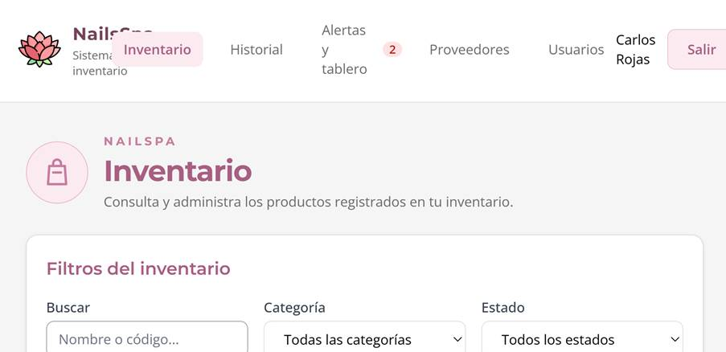

### Evidencia 2

Prueba simulando el ancho de un celular (antes de corregir).

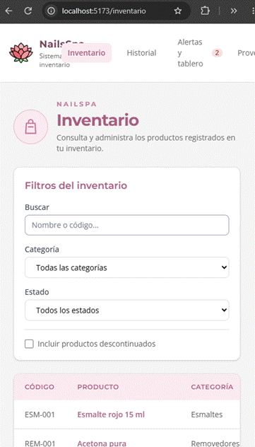 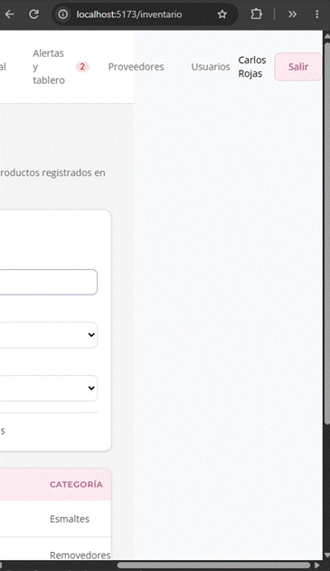

### Evidencia 3

Comparación del encabezado de Inventario (arriba) con el de Alertas y tablero (abajo), antes de corregir.

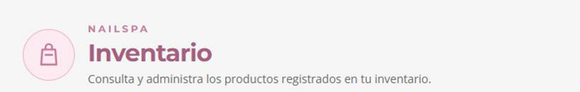

### Evidencia 4

Estilo del texto en Inventario (arriba) frente a Productos por reponer, Exportar datos y Proveedores cercanos (abajo), antes de corregir.

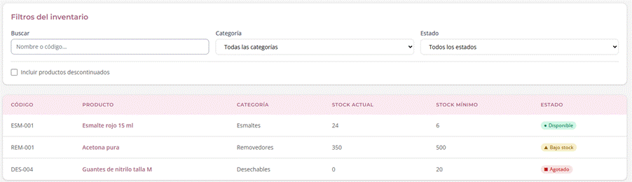

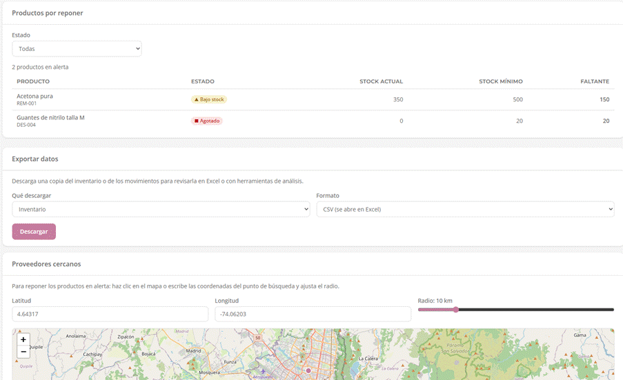

### Evidencia 5

Foco poco visible en la tabla de Inventario (antes de corregir).

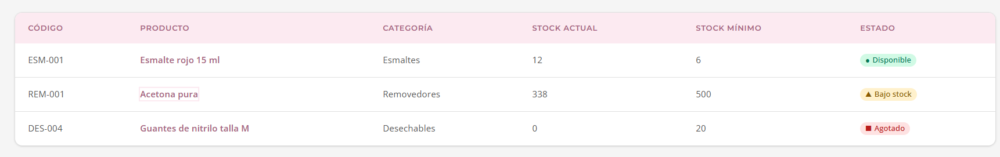

### Evidencia 6

Inventario, axe: incidencia 1 de 9 por contraste insuficiente (3,93; se requiere 4,5) en el enlace activo del menú.

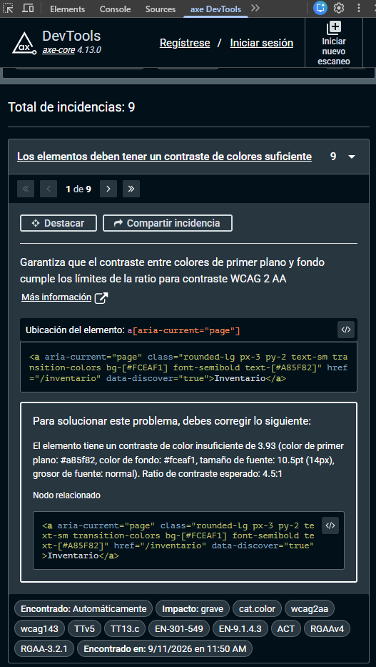

### Evidencia 7

Alertas y tablero, axe: un marcador de Leaflet con rol de botón y sin nombre accesible.

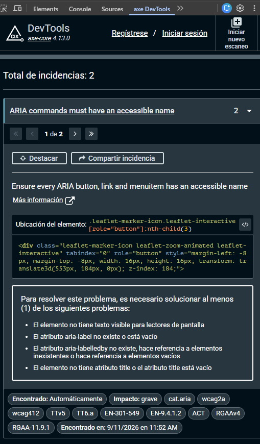

### Evidencia 8

Usuarios, axe: las 3 incidencias de contraste insuficiente (enlace activo del menú, botón con borde rosado y botón principal).

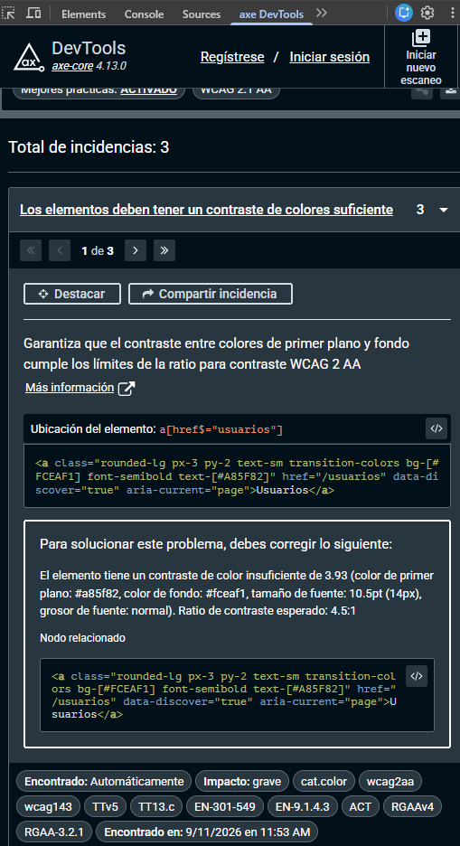

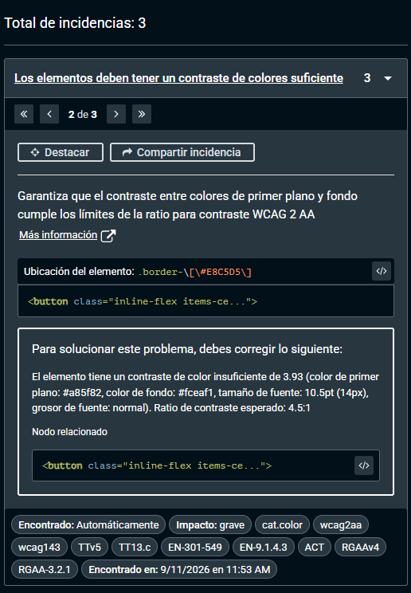

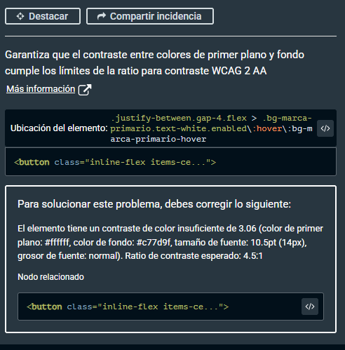

### Evidencia 9

Después de corregir: el menú se acomoda en varias filas con un ancho equivalente a 250 % de zoom y no se superpone con el logo ni con el contenido.

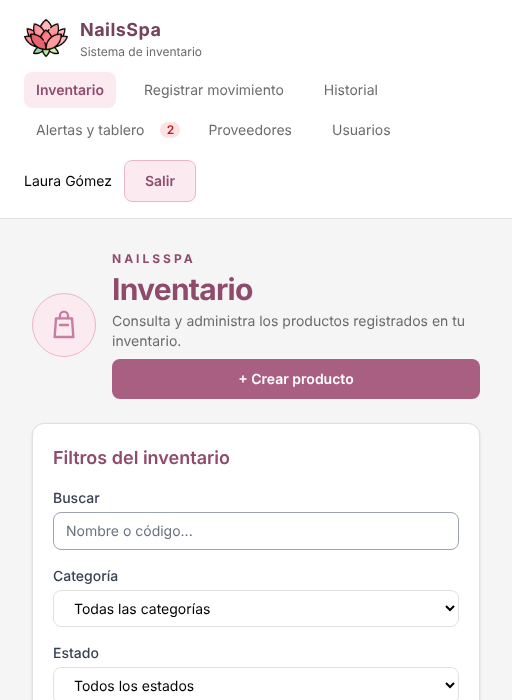

### Evidencia 10

Después de corregir: el foco del enlace «Esmalte rojo 15 ml» se ve con un anillo oscuro.

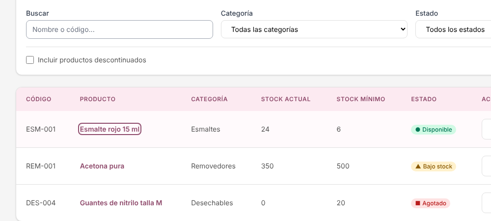

### Evidencia 11

Después de corregir: Alertas y tablero con el mismo encabezado de Inventario, títulos de tarjetas y tabla con el mismo estilo.

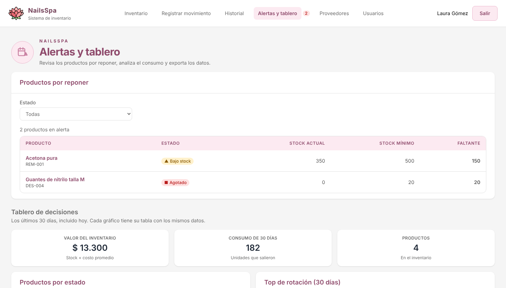

### Evidencia 12

Usuarios, antes (arriba) y después (abajo) de corregir: encabezado con ícono, descripción, botón principal con mejor contraste y tabla con el estilo de Inventario.

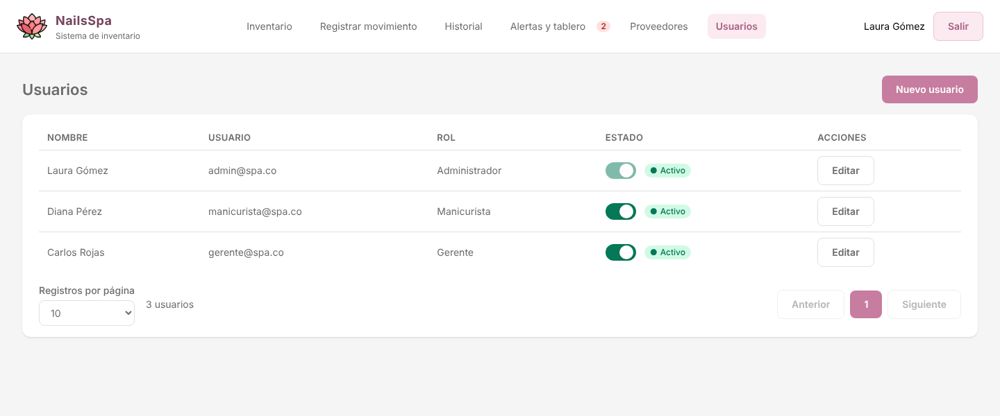

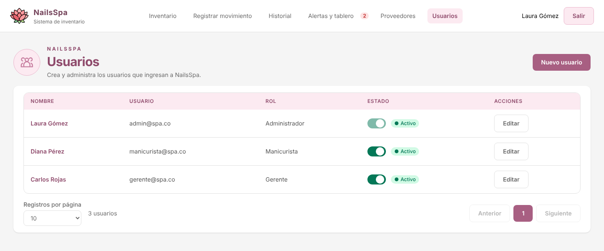
